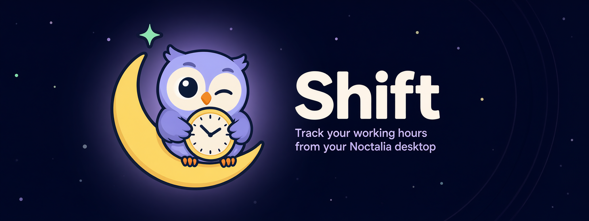
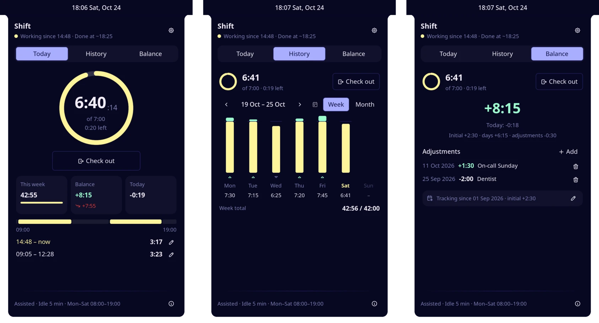
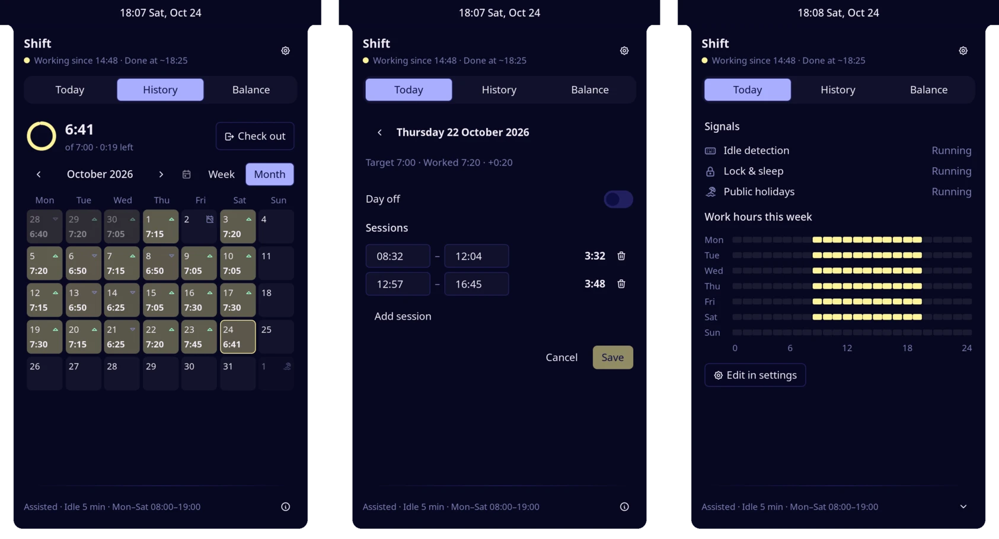
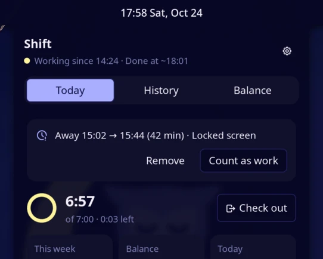
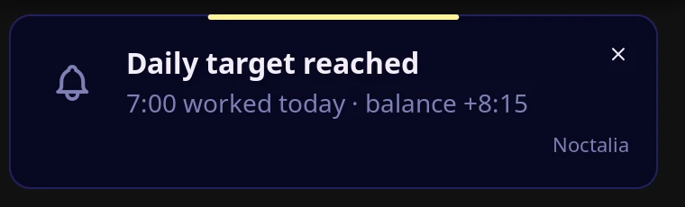
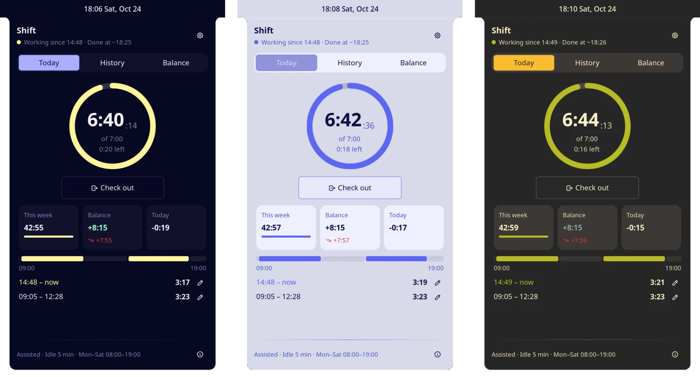

<div align="center">



<br />

[](https://github.com/hbollon/shift/actions/workflows/ci.yml) [](https://github.com/hbollon/shift/releases/latest) [](https://github.com/noctalia-dev/noctalia) [](LICENSE) [](https://www.conventionalcommits.org) [](https://github.com/hbollon/shift/stargazers)

**Check in with one click. Let automation catch the rest. Always know where your overtime stands.**

[Install](#-install) · [User guide](docs/user-guide.md) · [Changelog](CHANGELOG.md) · [Contributing](CONTRIBUTING.md)

</div>

---

Shift is a work-hours tracker for the [Noctalia](https://github.com/noctalia-dev/noctalia) shell. Your contract says 35 hours a week: Shift turns it into a daily target, counts your time live from the bar, and keeps a running overtime balance — with public holidays, days off and time-off adjustments taken into account. Forgot to check in? Locked your screen for a meeting? Shift notices, and asks instead of guessing.

No account, no cloud, no timesheet: your data stays in a few JSON files on your machine.

<p align="center">
  
</p>

## ✨ Features

|   |   |
| --- | --- |
| ⏱️ **One-click tracking** | Check in or out from the bar widget, the control-center tile, the dashboard or a keybind. A live ring shows today's progress toward your target, with the time you're done. |
| 🤖 **Automation you stay in control of** | *Assisted* suggests check-ins when you sit down within your work hours; *Automatic* does it for you. Idle, lock and sleep detection spot absences, and Shift asks whether they were work. |
| 📊 **An honest overtime balance** | Weekly hours split over your workdays, public holidays for your country, days off, and adjustments for time off or HR corrections. Contract changes never rewrite the past. |
| 🗓️ **History you can fix** | Week bars and a month calendar. Click any day to edit its sessions (`9:30`, `930` or `9h30`), mark it off, or review a day without sessions. Undo is one click away. |
| 🎨 **Theme-native** | Built only from Noctalia's palette roles and native controls: it follows your theme, light or dark. |
| 🔒 **Private and safe** | Local data only, daily backups with automatic restore of a damaged file, and a single optional network call for public holidays. No telemetry. |

<p align="center">
  
</p>

## 🚀 Install

Shift needs [Noctalia](https://github.com/noctalia-dev/noctalia) **5.2.0 or newer**.

**From the plugin store**: open Noctalia's settings → *Plugins*, search for **Shift** and enable it.

**From this repository** (latest release, before it reaches the store):

```sh
noctalia msg plugins source add shift git https://github.com/hbollon/shift
noctalia msg plugins enable hbollon/shift
```

Then add the **Shift** widget to a bar, and optionally the **Shift** shortcut to the control center.

**Optional tools**: [`swayidle`](https://github.com/swaywm/swayidle) for idle detection, and `gdbus` (GLib, `libglib2.0-bin` on Debian/Ubuntu) or `loginctl` for lock and sleep detection. Shift works without them, with less automation.

## 🏁 Quick start

1. **Set your contract**: weekly hours and workdays in the plugin settings (35 h, Monday–Friday by default).
2. **Check in**: right-click the bar widget. Left-click it to open the dashboard.
3. **Let it run**: with the default *Assisted* preset, Shift suggests checking in when you start working within your work hours (08:00–19:00), and asks about long absences when you come back.

The [user guide](docs/user-guide.md) covers the rest: editing days, the balance, automation rules, notifications, backups and keybinds.

<table>
  <tr>
    <td width="55%"></td>
    <td>
      <b>Absences, handled honestly.</b><br />
      Away for 42 minutes with the screen locked? When you come back, Shift asks: count it as work (a meeting, a call) or remove it. Short breaks always count as work.
      <br /><br />
      
    </td>
  </tr>
</table>

<p align="center">
  
</p>

## 📖 Documentation

| | |
| --- | --- |
| [User guide](docs/user-guide.md) | How to use Shift, from the first check-in to the overtime balance. |
| [Plugin page](shift/README.md) | Entries, settings, IPC, and every file, process and network call (as shown in the store). |
| [Changelog](CHANGELOG.md) | What changed in each release. |
| [Specification](docs/specs/0001-shift-v1.md) | Behavior, UX, architecture and the decisions behind them. |

## 🤝 Contributing

Bug reports, ideas and pull requests are welcome. Shift is written in [Luau](https://luau.org) against Noctalia's plugin API, with a pure core covered by unit tests:

```sh
make tools   # pinned toolchain, checksum-verified
make check   # tests, type-check, store validation
make dev-install   # run your checkout on your Noctalia
```

Read [CONTRIBUTING.md](CONTRIBUTING.md) for the setup and conventions, then pick an [open issue](https://github.com/hbollon/shift/issues) or [open a new one](https://github.com/hbollon/shift/issues/new). Translations go through [Noctalia Translate](https://i18n.noctalia.dev).

## ⭐ Support the project

If Shift saves you a timesheet, **[give it a star](https://github.com/hbollon/shift/stargazers)**: it helps other Noctalia users find it.
You can also [follow @hbollon](https://github.com/hbollon) for future projects, and share Shift with your team.

## 📄 License

[MIT](LICENSE) © Hugo Bollon
