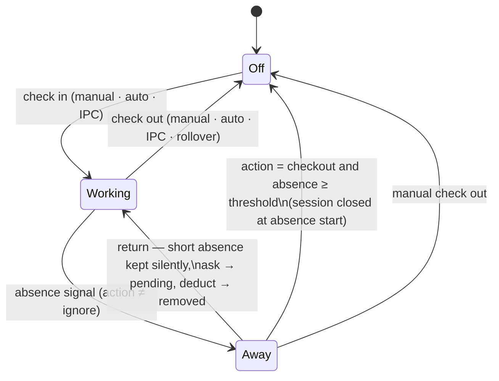
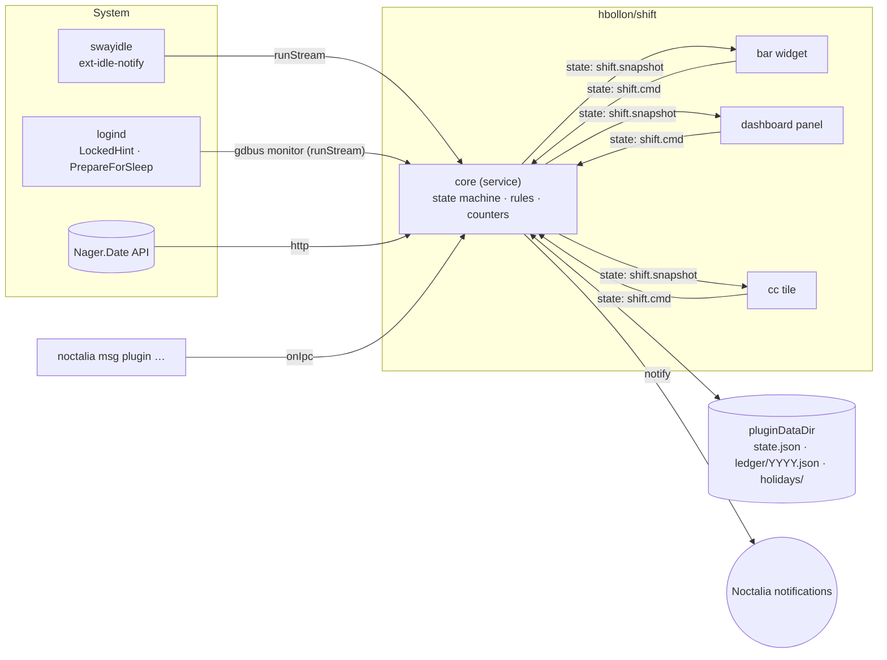

# Shift — Work-Hours Tracker for Noctalia v5

| | |
|---|---|
| **Spec** | 0001 — Shift v1 (core tracking, bar widget, panel, control-center tile) |
| **Status** | Reviewed — 2026-10-09 |
| **Author** | Hugo Bollon (`hbollon`) |
| **Created** | 2026-10-09 |
| **Target** | Noctalia ≥ 5.2.0 · `plugin_api = 32` |
| **Plugin id** | `hbollon/shift` |
| **Related** | Future spec: *0002 — Notifications & reminders* (out of scope here) |

---

## Table of contents

1. [Summary](#1-summary)
2. [Goals and non-goals](#2-goals-and-non-goals)
3. [Users and key stories](#3-users-and-key-stories)
4. [Glossary](#4-glossary)
5. [Platform context: what Noctalia v5 gives us](#5-platform-context-what-noctalia-v5-gives-us)
6. [Functional specification](#6-functional-specification)
7. [UX and visual design](#7-ux-and-visual-design)
8. [Settings](#8-settings)
9. [Architecture](#9-architecture)
10. [Data model and persistence](#10-data-model-and-persistence)
11. [IPC reference](#11-ipc-reference)
12. [Edge cases](#12-edge-cases)
13. [Non-functional requirements](#13-non-functional-requirements)
14. [Repository layout, tooling and distribution](#14-repository-layout-tooling-and-distribution)
15. [Milestones](#15-milestones)
16. [Risks and technical spikes](#16-risks-and-technical-spikes)
17. [Out of scope / future work](#17-out-of-scope--future-work)
18. [Decision log](#18-decision-log)

---

## 1. Summary

**Shift** is a Noctalia v5 plugin to track and control your working hours from the desktop shell. It answers three
questions at a glance — *am I working right now?*, *how much have I worked today?*, *how much overtime have I
banked?* — and lets you act on them in one click.

Tracking is **manual-first and automation-assisted**: a Check in / Check out toggle is always the source of truth,
while configurable automation (activity, session lock, sleep, and schedule rules that can be combined, included or
excluded) can check you in and out, or ask you what to do with an absence. Nothing is ever silently discarded:
ambiguous time is surfaced and resolved by the user.

Shift computes a live daily counter against a contractual target derived from weekly hours, and maintains an
**overtime balance** that the user can adjust manually (e.g. "took 2 h off", "HR regularisation +3 h"). Public
holidays are fetched automatically per country.

The UI is built entirely from Noctalia's native declarative controls and palette roles, so it follows every user
theme (light/dark, custom palettes) with zero hard-coded colors.

## 2. Goals and non-goals

### 2.1 Goals (v1)

| ID | Goal |
|----|------|
| G1 | Track work sessions with a one-click Check in / Check out, from the bar, the panel, the control center, and IPC. |
| G2 | Show a live, glanceable daily counter with progress toward the daily target and an estimated end time. |
| G3 | Compute a trustworthy overtime balance (weekly hours split evenly over workdays, holidays, manual adjustments). |
| G4 | Offer configurable, combinable automation: idle, lock, sleep, and schedule rules with include/exclude semantics. |
| G5 | Never lose or silently drop time: every absence above a threshold is recorded and resolvable; all edits are reversible. |
| G6 | Let the user review and correct the past: history (week/month), per-day session editing, balance ledger. |
| G7 | Notify once when the daily target is reached. |
| G8 | Look native and modern on any Noctalia theme; be pleasant and self-explanatory for first-time users. |
| G9 | Be publishable on GitHub and in the Noctalia community plugin store (review-friendly code, docs, thumbnail). |

### 2.2 Non-goals (v1)

- Advanced notifications and reminders (forgot to check out, max daily duration, break reminders, weekly target…) —
  covered by a dedicated future spec.
- Typed absences (vacation / sick / recovery categories, half-days). v1 handles time off through **manual balance
  adjustments** and a simple, uncategorised **day off** marker (see [D7](#18-decision-log), [D15](#18-decision-log)).
- Contracts other than "weekly hours split evenly across selected workdays" (per-weekday targets, annualisation,
  RTT, reset periods). The data model must not prevent them later.
- Project / client / task tagging, billing, invoicing.
- Multi-device sync, cloud storage, team features.
- Desktop widget and launcher provider (candidates for v1.x).
- CSV / iCal export (v1.x).

## 3. Users and key stories

**Primary persona — the salaried desk worker on Linux.** Has a contract (e.g. 35 h/week), occasionally works late
or leaves early, wants to know their overtime balance without a spreadsheet, and does not want to babysit a timer.

**Secondary persona — the flexible/remote worker.** Irregular hours, works from home, forgets to check out, wants
automation to do the boring part but stay in control.

| ID | As a… | I want to… | So that… |
|----|-------|-----------|----------|
| US1 | worker | check in/out with one click from the bar | tracking costs me nothing |
| US2 | worker | see today's worked time and how much is left | I know when I can leave |
| US3 | worker | see my overtime balance | I know how many hours I can take off |
| US4 | worker | record that I took 2 h off from my balance | the balance reflects reality |
| US5 | flexible worker | be checked in automatically when I start using my PC on a workday morning | I don't forget |
| US6 | flexible worker | exclude weekends, lunch, or specific dates from automation | automation doesn't track my private time |
| US7 | worker | be asked, when I come back from a long absence, whether it was work (meeting) or not | my time is accurate without guesswork |
| US8 | worker | fix yesterday's sessions when I forgot to check out | one mistake doesn't corrupt my balance forever |
| US9 | worker | have public holidays handled automatically | I don't get a −7 h day on May 1st |
| US10 | worker | get a notification when I've done my day | I can stop on time |
| US11 | power user | drive Shift from keybinds/scripts | I can integrate it into my workflow |
| US12 | any user | have Shift match my Noctalia theme | it looks like part of my desktop |

## 4. Glossary

| Term | Definition |
|------|-----------|
| **Session** | A contiguous interval of work `[start, end)`. The open session has no `end` yet. |
| **Workday** | The tracking day. Starts at `day_start_hour` (default 04:00 local) and lasts 24 h, so late-night work belongs to the day it started. A session belongs to the workday its `start` falls in. |
| **Workdays (contract)** | Weekdays on which the contract expects work (default Mon–Fri). |
| **Daily target** | Expected work for a workday: `weekly_hours / count(workdays)` on a contract workday that is not a public holiday, else `0`. |
| **Worked** | `Σ session durations − Σ removed absences` for a workday. |
| **Delta** | `worked − target` for a workday. |
| **Balance** | `initial_balance + Σ delta(closed workdays since tracking start) + Σ adjustments`. Excludes today (see §6.6). |
| **Adjustment** | A signed manual entry in the balance ledger (e.g. `−2:00 "Dentist"`). |
| **Signal** | An observed system event: `idle`/`active`, `lock`/`unlock`, `sleep`/`resume`, `offline gap`. |
| **Absence** | An interval during an open session where signals say the user was away. Has a status: `pending`, `kept`, `removed`. |
| **Window** | The set of instants where automation is allowed to act, computed from **schedule rules**. |
| **Rule** | One line of the schedule DSL, including (`+`) or excluding (`−`) days, dates, time ranges, or holidays. |
| **Override** | A manual action that suppresses contrary automation until the current window segment ends. |

## 5. Platform context: what Noctalia v5 gives us

Noctalia v5 is a native C++/Wayland rewrite with **no Qt/QML**. v4 QML plugins are obsolete. A v5 plugin is a
directory with a static `plugin.toml` manifest and **Luau** entry scripts, each running in an isolated VM off the UI
thread with per-call time budgets. This section records the capabilities and constraints that shape this spec
(verified against Noctalia 5.2.1 docs and source).

### 5.1 Capabilities we use

| Capability | API | Used for |
|-----------|-----|----------|
| Headless service | `[[service]]`, `update()`, `onConfigChanged()`, `onExit(signal, reason)` (API 17) | Single source of truth: state machine, signals, persistence |
| Bar widget | `[[widget]]`, `barWidget.render(ui.*)`, tooltips, `isVertical()` | Glanceable status + quick toggle |
| Panel | `[[panel]]`, `panel.render`, `setWantsSecondTicks`, `openContextMenu` (API 28) | Dashboard, history, editors |
| Control-center tile | `[[shortcut]]`, `shortcut.setLabel/setIcon/setActive` | One-click toggle |
| Shared state | `noctalia.state.set/get/watch` (in-memory, plain values, copied) | Service → UI snapshots, UI → service commands |
| Persistence | `noctalia.pluginDataDir()`, `writeFile`, `renameFile`, `json.*` | Durable data that survives plugin updates |
| Processes | `noctalia.runStream(cmd, onLine)`, `runAsync(argv, cb)` (API 24), `commandExists` | Idle (swayidle) and logind monitoring |
| HTTP | `noctalia.http(request, cb)` | Public holidays |
| Theme | Palette role tokens incl. alpha (`primary/0.6`), `noctalia.getColor(role)` (API 31), `isDarkMode()` | Theme-native rendering, SVG ring |
| Container tooltips | `tooltip` on `ui.box/row/column/image` (API 32) | Rich hover info in history charts |
| Time | `os.time`, `os.date`, `noctalia.nowMs()` (API 12), `noctalia.timeFormat()` (API 19) | Clocks, 12/24 h formatting |
| Modules | `require("./lib/x.luau")` (API 22) | Shared, testable pure logic |
| Settings GUI | Typed `[[setting]]` schema, `visible_when`, `advanced`, `openSettings()` (API 15) | All policy configuration |
| Shell config read | `noctalia.getSetting(path)` (API 26) | Respect `shell.offline_mode` |
| IPC | `onIpc(event, payload)` via `noctalia msg plugin …` | Scripting, keybinds, external idle daemons |
| i18n | `noctalia.tr/trp`, `translations/en.json` | All user-visible strings |

`plugin_api = 32` (the level shipped by Noctalia 5.2.0) is required for `getColor` and container tooltips.

### 5.2 Constraints and how we handle them

| # | Constraint | Consequence / decision |
|---|-----------|------------------------|
| C1 | **No idle/activity API for plugins.** | Use `swayidle` (optional dependency) through `runStream`. It is a standalone `ext-idle-notify-v1` client and works on every compositor Noctalia supports. An `external` backend accepts idle events over IPC (hypridle, custom daemons). |
| C2 | Noctalia's own `[idle.behavior.*]` could call our IPC, **but** its pre-action fade (`pre_action_fade_seconds`) applies to *every* behavior, including `command` ones (verified in `src/idle/idle_manager.cpp`). | Rejected: it would dim the screen at every tracking threshold. |
| C3 | **No lock/sleep API for plugins.** Noctalia does set logind's `LockedHint` when it locks (`src/dbus/logind/logind_service.cpp`). | Monitor logind over D-Bus (`gdbus monitor --system`), for both `LockedHint` and `PrepareForSleep`. Fallback: poll `loginctl show-session`. A clock-gap detector covers anything missed. |
| C4 | Noctalia `[hooks] session_locked` exists but is a **single key**: writing it would override the user's own hook. | Not used. |
| C5 | **Plugins cannot write their own settings** (read-only `getConfig`). | Strict split: *policy* lives in Noctalia settings (edited in the settings GUI, opened via `openSettings()`), *facts* (sessions, adjustments, initial balance, tracking start) live in our data files and are edited in the panel. |
| C6 | `noctalia.state` is in-memory, copied, and cleared when the plugin stops. | Durable data goes to `pluginDataDir()`. State carries compact snapshots; UIs compute the live counter locally from timestamps to avoid 1 Hz state churn. |
| C7 | `noctalia.notify(title, body)` has no action buttons. | v1 notifications are informative only. Action buttons are deferred to spec 0002. |
| C8 | Declarative UI has no date/time picker, no chart beyond `ui.graph` (line), no absolute positioning. | Time entry uses validated text inputs with smart parsing. Bar charts are built from `ui.box` heights. The progress ring is an SVG generated with palette colors (the image loader supports SVG via librsvg), with a `ui.progress` fallback. |
| C9 | Bar widgets: one control tall, no keyboard, no `ui.input/select/scroll`. | The bar shows status and supports a quick toggle; all editing happens in the panel. |
| C10 | The plugin system is **beta**; manifest/API may still change. | Keep the API surface small, pin `plugin_api`, and isolate host calls behind a thin adapter (`lib/host.luau`). |

## 6. Functional specification

### 6.1 Tracking state machine

The service owns a single tracking state:

| State | Meaning |
|-------|---------|
| `off` | No open session. |
| `working` | An open session exists and no absence is in progress. |
| `away` | An open session exists and a signal currently reports the user absent (idle, locked, asleep). Time keeps accruing provisionally. |

Orthogonal flags exposed to the UI:

- `suggestion`: `checkin` | `checkout` | `nil` — automation suggests an action (assisted mode).
- `pending`: list of unresolved absences (any workday).
- `override`: the active manual override, if any (see §6.3.4).



**Invariants**

- At most one open session at any time.
- Sessions never overlap; sessions of a workday are kept sorted.
- Every transition is persisted before the snapshot is published (crash-safe ordering).
- Every user-visible mutation can be undone (see §6.8.4).

### 6.2 Manual tracking

- **Check in**: opens a session at *now*. Ignored if already `working`/`away`.
- **Check out**: closes the open session at *now*. If `away`, the in-progress absence becomes `pending` (closed at
  now) and is resolved like any other.
- **Toggle**: check in when `off`, check out otherwise.
- Available from: bar widget (right-click by default), panel primary button, control-center tile, IPC.
- A manual action always wins over automation and sets an **override** (§6.3.4).

### 6.3 Automation

Automation is a set of independent behaviors driven by **signals** and constrained by **windows**. Each behavior is
configurable. A preset selects sensible combinations.

#### 6.3.1 Presets

| Preset | Auto check-in | Auto check-out | Idle | Lock | Sleep / offline |
|--------|---------------|----------------|------|------|-----------------|
| `manual` | off | off | ignore | ignore | ignore |
| `assisted` *(default)* | suggest | suggest | ask | ask | ask |
| `automatic` | auto | auto | ask | ask | ask |
| `custom` | *setting* | *setting* | *setting* | *setting* | *setting* |

With `custom`, the individual settings in §8 become visible (`visible_when`).

#### 6.3.2 Signals

| Signal | Source | Event time semantics |
|--------|--------|---------------------|
| `idle` / `active` | `swayidle -w timeout <T> 'echo idle' resume 'echo active'` via `runStream`, or the `external` backend through IPC `signal idle|active`. | Absence start = `idle event time − T` (the user was already inactive for `T`). |
| `lock` / `unlock` | logind `LockedHint` on our session object (`gdbus monitor --system --dest org.freedesktop.login1`). | Absence start = lock time. |
| `sleep` / `resume` | logind `PrepareForSleep(true/false)` on the Manager object. | Absence start = `PrepareForSleep(true)` time. |
| `gap` (offline) | Service tick: wall clock advanced by more than `3 × tick + 30 s` since the last tick, **or** at startup the persisted heartbeat is older than 2 min while a session was open. | Absence start = last heartbeat / last tick. Treated like `sleep`. |
| `activity` | Derived: service start, `active`, `unlock`, `resume`. | Used by auto check-in. **While the session is locked, `active` is not activity** (it fires on the first key press on the lock screen); only `unlock` ends a lock absence. `active`/`idle` flaps shorter than 2 s are debounced. |

Backend health (running / unavailable / error + reason) is part of the snapshot and shown in the panel (§7.4.6).
`idle_backend = auto` picks `swayidle` when `commandExists("swayidle")`, else disables idle detection and shows a
one-time hint ("Install swayidle to enable idle detection").

#### 6.3.3 Schedule rules (windows)

Rules define **when automation may act**. They do *not* define the contract (that is `weekly_hours` + workdays,
§6.6). The window is configured in two layers (D29):

1. **Base window** (typed settings, §8.3): `window_start` and `window_end` (`HH:MM`) on the contract workdays, plus
   public holidays excluded when `window_exclude_holidays` is on. It is equivalent to the implicit rules
   `+ <workdays> <window_start>-<window_end>` and `- holidays`.
2. **Additional rules** (`extra_rules`, `string_list`): `+`/`−` lines in the DSL below, for exceptions such as lunch,
   short Fridays or a winter break.

Days off (§6.6.1) are always excluded. All rules (implicit and additional) are evaluated as:

```
window(t) = (∃ include rule matching t) ∧ ¬(∃ exclude rule matching t)
```

Exclusions always win. With no include rule (e.g. `window_start` = `window_end`), there is no window and automation
never acts on its own (absence handling still applies to sessions started manually).

The native list editor supports add, remove and reorder but not in-place editing (spike S4), which is why the
everyday schedule uses typed settings and the DSL is reserved for exceptions.

**Grammar (EBNF)**

```ebnf
rule       = sign , ws , selector , [ ws , timerange ] ;
sign       = "+" | "-" ;
selector   = "*" | "holidays" | days | date | daterange ;
days       = dayspec , { "," , dayspec } ;
dayspec    = day | day , "-" , day ;            (* ranges may wrap: fri-mon *)
day        = "mon" | "tue" | "wed" | "thu" | "fri" | "sat" | "sun" ;
date       = YYYY "-" MM "-" DD ;
daterange  = date , ".." , date ;               (* inclusive *)
timerange  = HH ":" MM , "-" , HH ":" MM ;      (* end > start; "24:00" allowed as end *)
```

Rules are case-insensitive and surrounding whitespace is ignored. A rule without a time range covers the whole
calendar day. Dates refer to local calendar dates.

**Examples**

| Rule | Meaning |
|------|---------|
| `+ mon-fri 08:00-19:00` | Automation active on weekdays, 8 am–7 pm. |
| `- * 12:00-13:30` | Exclude lunch every day: auto check-out at 12:00, auto check-in on activity after 13:30. |
| `- fri 16:00-24:00` | Short Fridays. |
| `- sat,sun` | Never on weekends (useful with a broad `+ * 07:00-21:00`). |
| `- 2026-12-24..2027-01-02` | Exclude the winter break. |
| `- holidays` | Exclude public holidays (§6.7). |

**Defaults:** base window `08:00`–`19:00` on the contract workdays (Mon–Fri), holidays excluded, `extra_rules = []`.

**Validation:** invalid `HH:MM` values and invalid rule lines are skipped, never fatal. Each one is reported with its
setting, index, text and reason in the snapshot (`automation.ruleErrors`). The panel shows them with an "Edit in
settings" button (`openSettings()`).

**Preview:** the panel's automation card shows a compact 7 × 24 heat strip of the effective window for the current
week, so users can check their rules visually (§7.4.6).

#### 6.3.4 Automation behaviors

**Auto check-in** (`off` | `suggest` | `auto`)

Triggers when **all** of the following hold:
1. state is `off`;
2. `window(now)` is true;
3. an `activity` event occurs, or the window opens while the user is active (not idle, not locked);
4. no override suppresses check-in for the current window segment.

`auto` checks in at the activity time. `suggest` sets `suggestion = "checkin"`, shown as visual cues (bar
attention state and a panel suggestion card, §7.3, §7.4.2) and, when `notify_suggestions` is on (default), **one**
informational notification per window segment (D16). A suggestion is cleared when the user acts on it, dismisses it (*Not now*, which suppresses it for the rest of
the segment), or the window segment ends.

**Auto check-out** (`off` | `suggest` | `auto`)

Triggers when the state is `working`/`away`, the window closes (transition `true → false`), and no override
suppresses it. `auto` closes the session at the window end. `suggest` sets `suggestion = "checkout"`, with the same
cues and notification rule as check-in suggestions.
Sessions opened manually **outside** any window are never auto-closed by window edges.

**Overrides.** A window *segment* is a maximal contiguous interval where `window(t)` is true.
- A manual check-out inside a segment suppresses auto check-in until that segment ends.
- A manual check-in outside a window marks the session as manual: window edges will not close it.
- A manual check-in inside a segment cancels a pending check-out suggestion for that segment.

Overrides are kept in `state.json` so they survive restarts.

#### 6.3.5 Absence handling

While a session is open, a signal reporting the user absent moves the state to `away` and opens an **absence
candidate**. Overlapping signals merge into one absence: start = earliest start, end = latest return. The
**effective action** is the one configured for the strongest signal involved (precedence `sleep/gap > lock > idle`).

| Action | Behavior |
|--------|---------|
| `ignore` | Nothing is recorded. The state stays `working`. |
| `ask` *(default)* | On return, if duration ≥ `min_absence_min`, the absence is recorded as `pending`. Time is counted provisionally until resolved. |
| `deduct` | On return, if duration ≥ `min_absence_min`, the absence is recorded as `removed`. The session stays open and remains reversible. |
| `checkout` | As soon as the absence duration crosses `min_absence_min` (even while still away), the session is closed at the absence start. On return, auto check-in may apply. |

Absences shorter than `min_absence_min` (default 15 min) are always counted as work and not recorded. Micro-breaks
are part of work.

**Resolution UX (pending).** On return the bar widget switches to an attention state. The panel shows a card per
pending absence: *"Away 10:12 → 10:54 (42 min) — Locked screen"* with **[Count as work]** **[Remove]**. When
`notify_pending_absence` is on (default), one informational notification is posted: *"You were away 42 min — open
Shift to review."*

**Unresolved absences** are resolved with `unresolved_absence` (default `keep`) when their workday rolls over. They
stay editable from the day editor afterwards.

### 6.4 Workday rollover

At each workday boundary (`day_start_hour`):
- An open session is **closed** at the last known activity time (last `active`/`unlock`/`resume`/check-in,
  whichever is latest), or at the boundary if unknown. The day is flagged `needsReview`.
- If the user is active right after the boundary and auto check-in conditions hold, a new session starts normally.
- Pending absences of the closed day are resolved with `unresolved_absence`.

This keeps "forgot to check out" from leaking into the next day. The proper reminder is spec 0002.

### 6.5 Counters

All computations use epoch seconds (DST-safe). Workday attribution uses local time at the session start.

| Counter | Formula |
|--------|---------|
| `today.worked` | `Σ closed sessions + (open ? now − open.start : 0) − Σ removed absences` (pending counted) |
| `today.target` | daily target of the current workday (§6.6) |
| `today.remaining` | `max(0, target − worked)` |
| `today.overtime` | `max(0, worked − target)` |
| `today.progress` | `target > 0 ? worked / target : (worked > 0 ? 1 : 0)` (may exceed 1) |
| `today.eta` | `now + remaining` while `working`, else `nil` |
| `week.worked` / `week.target` | Σ over the ISO week (Mon–Sun) |
| `balance` | settled balance (excludes today), §6.6 |

UIs receive `workedClosedMs`, `openStartMs` and `removedInOpenMs` in the snapshot and compute the live value
locally, so the service does not need to publish every second.

### 6.6 Contract, targets and balance

**Contract (v1).** `weekly_hours` (default 35) is split evenly across the selected contract workdays (default
Mon–Fri): `daily_target = weekly_hours / count(workdays)` (35 h → 7:00). The data model stores the daily target
*per weekday* internally (`targets[1..7]`), so per-weekday contracts can be added later without migration.

**Target of a given workday**

```
target(d) = 0                          if d < tracking_start
          = 0                          if weekday(d) ∉ workdays
          = 0                          if d is a public holiday (§6.7) on a contract workday
          = 0                          if d is marked as a day off (§6.6.1)
          = daily_target               otherwise
```

Contract changes apply **from the day they are made**: the service snapshots `{fromDate, weeklyHours, workdays}`
into `contractHistory`, so past deltas are not recomputed retroactively.

**Balance**

```
balance = initial_balance
        + Σ delta(d)  for d ∈ [tracking_start, today − 1], d not an unreviewed missing day
        + Σ adjustments
```

- The **headline balance excludes today**. Today's contribution is shown separately as *"Today: −1:18"* / *"Today:
  +0:23"*. This avoids a scary −7:00 every morning, and today's delta is folded in at rollover.
- **Missing days**: past days with a non-zero target (after tracking start, not holidays, not days off) and no
  sessions. They are **excluded from the balance until reviewed** (D23), so a day the PC stayed off never silently
  costs −7:00. The balance shows a counter (*"2 days to review"*) and the history flags them (`missing`). Each one is
  reviewed with a quick fix:
  - *Mark as day off* → target 0 (§6.6.1);
  - *Add session* → opens the day editor;
  - *Not worked* → confirmed as a real −target day (`flags.missingConfirmed`).
  Adding an adjustment dated that day does not review it.
- **Adjustments** (`{date, minutes, note}`) record partial time off and corrections. Examples: `−2:00 "Left early —
  dentist"`, `+3:00 "HR regularisation"`. Full days off use the day-off marker (§6.6.1).
- `initial_balance` and `tracking_start` are data, editable in the Balance tab. Defaults: `0:00` and the first-run
  date.

#### 6.6.1 Day off

A workday can be marked as a **day off**: its target becomes `0`, exactly like a public holiday. There is no category
(vacation, sick, recovery…) and no half-day in v1 (D15).

- Where: the day editor toggle (§6.8.2), the *Mark as day off* quick fix on missing days, and IPC `dayoff`.
- Future days can be marked in advance (e.g. next week's vacation) from the month view.
- Sessions recorded on a day off are kept and count entirely as overtime (target 0). Marking a day that has sessions
  asks for confirmation.
- A day off is also excluded from automation windows, like `- holidays` (no auto check-in on a vacation day).
- Stored as `flags.dayOff` in the ledger. Undoable like any mutation.

### 6.7 Public holidays

- Source: Nager.Date public API `GET https://date.nager.at/api/v3/PublicHolidays/{year}/{country}`.
- `holiday_country`: ISO 3166-1 alpha-2. Empty = auto-detect from `LC_TIME` / `LANG` (e.g. `fr_FR.UTF-8` → `FR`).
- `holiday_region` (advanced): ISO 3166-2 subdivision such as `FR-67` or `DE-BY`. A holiday applies if `global == true`
  or its `counties` contains the region.
- Cache: `holidays/{CC}-{year}.json` in the data dir, holding the current and the next year. Refreshed at most once
  per week and on country/region change.
- Offline: if `noctalia.getSetting("shell.offline_mode")` is true, or the fetch fails, the cache is used. When no
  cache exists, holidays are disabled with a visible hint. Failures never block tracking.
- Effect: target `0` on contract workdays, and the `holidays` selector in schedule rules (§6.3.3).
- This is the **only network access** of the plugin. It is documented in the README and can be disabled with
  `holidays_enabled = false`.

### 6.8 History, editing and undo

#### 6.8.1 Views
- **Week view**: 7 day columns with bars of worked hours vs target, plus the week total. Navigation ‹ › and "This week".
- **Month view**: calendar grid; each cell shows worked hours with an intensity tint and a delta marker. Navigation ‹ ›.
- Clicking a day opens the **day editor**.

#### 6.8.2 Day editor
- Header: date, target, worked, delta, status chips (`holiday`, `day off`, `missing`, `needs review`, `pending`).
- For a missing day, the three review actions of §6.6 are shown above the (empty) session list.
- **Day off** toggle (§6.6.1).
- Sessions list: start/end text inputs, computed duration, delete button. **Add session** button.
- Absences list (for that day): time range, signal, status with a Keep/Remove toggle.
- **Save** validates and applies everything atomically; **Cancel** discards.

#### 6.8.3 Time input parsing and validation
- Accepted: `9`, `09`, `930`, `0930`, `9:30`, `9h30`, `9.5` (decimal hours), and `21:15`/`9:15pm` if 12 h is
  configured. Values are normalised on blur/save and shown in the user's format (`noctalia.timeFormat()`).
- Durations (adjustments): `2`, `2:30`, `2h30`, `-1:15`, `+0:45`, `1.5`.
- Validation errors are shown inline in `error` color: end ≤ start, overlap with another session, outside the
  workday bounds, end in the future for today.

#### 6.8.4 Undo
- Every mutation (check in/out, absence resolution, edits, adjustments) pushes an inverse operation onto an undo
  stack (depth 20, in `state.json`).
- The panel header shows **Undo** for 10 minutes after the last action, with a tooltip naming it ("Undo check out at
  17:02"). It is also available over IPC (`undo`).

### 6.9 Notifications (v1)

- **Daily target reached**: once per workday, when `today.worked` crosses `today.target` (> 0) while working.
  Title *"Daily target reached"*, body *"7:00 worked today · balance +4:35"*. Controlled by `notify_target_reached`.
- **Pending absence**: one informational notification on return (§6.3.5). Controlled by `notify_pending_absence`.
- **Suggestion** (assisted mode): one informational notification per window segment (§6.3.4). Controlled by
  `notify_suggestions`.
- Everything else is deferred to spec 0002.

### 6.10 First run / onboarding

On first run (no data file):
1. The data dir is created with `tracking_start = today` and `initial_balance = 0`.
2. The panel shows a **welcome card** instead of the stats row:
   *"Shift tracks your working time. Contract: 35 h/week · Mon–Fri · 7:00/day · Automation: Assisted."*
   Buttons: **[Check in now]** (primary), **[Adjust settings]** (`openSettings()`), and a link-style
   **[Set starting balance]** that opens the Balance tab.
3. The card disappears after the first check-in or dismissal.

## 7. UX and visual design

### 7.1 Principles

1. **Glanceable**: the most important number (today's worked time) is readable in under a second from the bar.
2. **Calm**: no nagging. One notification per event, cues in place of alerts.
3. **Honest**: time is never silently dropped. Uncertainty is shown, not guessed.
4. **Reversible**: every action can be undone, and every past day can be edited.
5. **Native**: only Noctalia controls, palette roles and Tabler glyphs, no hard-coded colors, light/dark parity.
6. **Progressive disclosure**: presets first, details only in `custom`. Advanced settings stay behind "show advanced".

### 7.2 Visual language

**Color roles** (no hex values anywhere in the plugin; alpha variants like `primary/0.15` for tints):

| Meaning | Role |
|---------|------|
| Working / progress | `primary` |
| Overtime portion (beyond target) | `tertiary` |
| Needs attention (pending absence, suggestion, missing day) | `secondary` + attention glyph |
| Off / muted text | `on_surface_variant` |
| Cards / tracks | `surface_variant` (tracks at `/0.5`) |
| Borders / target markers | `outline` |
| Validation errors only | `error` |

Rule: **color is never the only carrier of meaning**. Each state also has a distinct glyph and/or label.

**Glyphs** (Tabler names verified present in Noctalia's font):

| Use | Glyph |
|-----|------|
| Plugin / working | `briefcase` |
| Off | `briefcase-off` |
| Check in / Check out buttons | `login-2` / `logout` |
| Away / pending | `clock-exclamation` |
| Suggestion | `clock-play` (check-in) / `clock-pause` (check-out) |
| Target reached | `clock-check` |
| Holiday | `beach` |
| Day off | `calendar-off` |
| Balance | `scale` |
| Adjustment | `plus-minus` |
| History | `chart-bar`, `calendar` |
| Undo | `history` |
| Lock / sleep signal | `lock` / `zzz` |
| Edit / delete | `pencil` / `trash` |

**Typography**: inherit the shell font. Numbers use bold weight; the hero counter uses a large size (~40 px) with
seconds in a smaller, muted label. `fontWeight` tiers: `bold` for values, `normal` for labels, `medium` for headers.

**Progress ring**: an SVG generated at runtime (track = `on_surface` at `stroke-opacity` ≈ 0.18, because
`surface_variant` is nearly invisible on bar and panel surfaces (spike S3); arc = `primary`, overtime arc =
`tertiary` drawn as a second lap), with colors resolved through `noctalia.getColor()`. Files are cached as
`cache/ring-{size}-{percent}-{paletteHash}.svg`, so at most ~100 files exist per palette and size, and stale ones are
pruned at startup. A palette change is detected by comparing `getColor` results on render. Fallback: `ui.progress`.

**Duration format** (setting): `7:30` (default), `7h 30m`, or `7.50 h`. Clock times follow `noctalia.timeFormat()`
(12/24 h).

### 7.3 Bar widget (`hbollon/shift:bar`)

**Horizontal bar, default style `full`:** status glyph · counter · progress ring.

```
 ╭───────────────╮   ╭───────────────╮   ╭───────────────╮   ╭───────────────╮   ╭──────────────╮
 │ 💼  3:12  ◔   │   │ 💼  7:23  ◉   │   │ ⏱!  5:42  ◔   │   │ ⌀  5:42  ◌    │   │ 💼  1:05     │
 ╰───────────────╯   ╰───────────────╯   ╰───────────────╯   ╰───────────────╯   ╰──────────────╯
   working             overtime            pending absence     off (muted)         no target today
```

The order reads as a sentence: *status* (glyph), *value* (counter), *where I stand* (ring). Each element has one job,
so none of them has to be overloaded, and the counter keeps the two pictograms apart.

| Element | Role | Rendering |
|---------|------|-----------|
| Glyph | Status, readable without color (§7.2) | `briefcase` working · `briefcase-off` off · `clock-exclamation` pending absence · `clock-play`/`clock-pause` suggestion |
| Counter | The `value` setting (worked time by default) | Neutral text color while working, muted when off; bold not used in the bar |
| Ring | Progress toward today's target | SVG ring (§7.2), **smaller than the glyph** (about 0.75× its size) with a thin stroke, so it stays secondary; exact size tuned on screenshots |

**Color budget**: at most two colored elements, the glyph and the ring's arc. The counter stays neutral.

| State | Glyph | Ring |
|-------|-------|------|
| Working | `primary` | arc `primary` |
| Overtime | `tertiary` | full `primary` circle + second lap in `tertiary` |
| Pending absence / suggestion | `secondary` | unchanged |
| Off | `on_surface_variant` | track and arc muted (`on_surface_variant`), still showing today's progress |

**Ring visibility rules**
- Hidden when today's target is 0 (non-workday, holiday, day off): there is nothing to progress toward.
- Kept (muted) when off, so the widget width does not change at each check in/out and the neighbouring widgets do
  not jump.

**Vertical bar:** a column with the glyph, then a compact value (`5h`). No ring: three stacked elements would be too
tall.

| Widget setting | Values | Default |
|---------------|--------|---------|
| `style` | `full` (glyph · counter · ring), `compact` (glyph · counter), `minimal` (counter only) | `full` |
| `value` | `worked`, `remaining`, `balance` | `worked` |
| `when_off` | `show`, `dim`, `hide` | `dim` |

**Tooltip** (rows): Status · Today `5:42 / 7:00` · Remaining `1:18 (~17:36)` · This week `28:10 / 35:00` · Balance
`+4:35` · Pending `1 absence`.

**Gestures:**
- Left click: toggle the panel (`noctalia.togglePanel("hbollon/shift:dashboard")`).
- Right click: quick toggle (check in/out). The panel's Undo is the safety net.
- Middle click: Noctalia's built-in widget settings (unchanged).

**Refresh**: 1 s update interval for live text (cheap: local arithmetic, re-render only when the displayed minute
or state changes).

### 7.4 Panel (`hbollon/shift:dashboard`)

Manifest defaults: `width = 400`, `height = 620`, `placement = "attached"`, `position = "auto"`,
`open_near_click = true`. Second ticks are enabled while open.

```
┌────────────────────────────────────────────┐
│ Shift                      Thu, Oct 9   ↶ ⚙ │  header: title · date · undo · settings
│ ● Working since 08:57                       │  status chip
├────────────────────────────────────────────┤
│ ⚠ Away 10:12 → 10:54 (42 min) · Locked     │  attention cards (0..n)
│               [Count as work]   [Remove]   │
├────────────────────────────────────────────┤
│               ╭───────────╮                │
│              ╱   5:42 ·17  ╲               │  hero: ring + live counter
│             │   of 7:00     │              │
│              ╲  1:18 left  ╱               │
│               ╰───────────╯                │
│           Done at ~17:36                   │
│        [  ⇥  Check out  ]                  │  primary action
├────────────────────────────────────────────┤
│ This week     Balance        Today         │  stat tiles
│ 28:10/35:00   +4:35 ⚖       −1:18          │
├────────────────────────────────────────────┤
│ [ Today ]  [ History ]  [ Balance ]        │  segmented tabs
│ ───────────────────────────────────────    │
│ 06  ▕██████▏▕░░▏▕████████▏         20      │  day timeline (sessions/gaps)
│ 08:57 – 12:31     3:34                     │
│ 13:22 – now       2:08                     │
├────────────────────────────────────────────┤
│ Assisted · Idle 5 m · Mon–Fri 08–19   ⓘ    │  automation footer
└────────────────────────────────────────────┘
```

#### 7.4.1 Header
Title, today's date (`noctalia.dateFormat()`), an **Undo** ghost button (visible for 10 min after an action, with
tooltip), and a **Settings** ghost button (`openSettings()`). The status chip shows a dot plus a label: *Working
since 08:57* / *Away for 12 min* / *Off — last session ended 17:02* / *Suggested: check in?*

#### 7.4.2 Attention cards
Stacked cards, most recent first, with a maximum of 3 (then "+2 more → History"): pending absences, suggestions
(*"It's 08:14 on a workday — start your shift?"* **[Check in]** **[Not now]**), rule errors, missing backend hints,
days flagged `needsReview`, and missing days to review (one grouped card: *"2 days to review"* → History).

#### 7.4.3 Hero
Ring (≈160 px) with `H:MM` in large bold and `:SS` small and muted, *"of 7:00"*, *"1:18 left"* or *"+0:23 over"* (in
`tertiary`). Under it: *"Done at ~17:36"* while working. On non-workdays it shows *"No target today"* and the ring
shows worked time with a neutral track. The primary button is **Check in** (`primary` variant) or **Check out**
(`outline` variant).

#### 7.4.4 Stat tiles
Three equal tiles (`surface_variant` fill, `radius` from shell style): **This week** (worked/target plus a thin
`ui.progress`), **Balance** (settled, with a trend glyph), **Today** (today's delta). Each tile is clickable and
opens the relevant tab.

#### 7.4.5 Tabs
- **Today**: day timeline (a row of proportional `ui.box` segments from `day_start_hour` to now, sessions in
  `primary`, kept absences in `primary/0.4`, removed absences hatched via `outline` border, gaps in
  `surface_variant/0.4`), followed by the session list. Clicking a session opens the day editor.
- **History**: week view by default, with a week/month toggle (§6.8.1). Bars use `primary` up to the target and
  `tertiary` above it. A target tick is drawn with an `outline` 1 px box. Holidays show `beach`, missing days show
  a `secondary` dot. Container tooltips show exact values.
- **Balance**: big balance value with a breakdown (initial balance · accumulated delta · adjustments) and the
  *days to review* counter when non-zero, the adjustment
  ledger (date, ±duration, note, delete), and an **Add adjustment** form (amount, date defaulting to today, note).
  It also has an editable *Tracking since* and *Initial balance* (with confirmation, since they change the balance).

#### 7.4.6 Automation footer
A one-line summary: preset · idle timeout · condensed window. A **ⓘ** opens an expandable section with backend health
(idle: swayidle ✓ / unavailable; lock & sleep: logind ✓), the 7 × 24 window preview strip, rule errors, and
**[Edit in settings]**.

#### 7.4.7 Keyboard
Standard focus/Enter/Space navigation (host-provided). `capture_keys = ["ctrl+z"]` triggers Undo while the panel
has focus. Escape closes the panel (host-owned).

### 7.5 Control-center tile (`hbollon/shift:tile`)

- Label: `Working · 5:42` / `Off · 5:42` / `Away · 5:42`. Icon: `briefcase` (on) / `briefcase-off` (off).
  `setActive(working or away)`.
- Click: toggle check in/out. Right click: open the panel.

### 7.6 Microcopy and i18n

- All strings live in `translations/en.json` with dotted keys (`panel.hero.left`, `notify.target.title`, …). Plurals
  use `noctalia.trp`.
- Tone: short, neutral, second person, never guilt-inducing ("1:18 left", not "You still owe 1:18").
- Other locales (French first) come through Noctalia Translate after publication. No machine-translated files are
  committed (community-plugins rule).

### 7.7 Accessibility
- Never rely on color alone (§7.2).
- Every glyph-only button has a tooltip.
- Text sizes ≥ 12 px. Contrast inherits palette `on_*` pairs.
- Every action is reachable by keyboard in the panel and over IPC.

## 8. Settings

All labels and descriptions are translation keys (`settings.<key>.label` / `.description`). *Scope* P = plugin-level
`[[setting]]`, W = `[[widget.setting]]`.

### 8.1 Contract

| Key | Type | Default | Scope | Notes |
|-----|------|---------|-------|-------|
| `weekly_hours` | double | `35` | P | min 0, max 100 |
| `work_week` | select | `mon_fri` | P | `mon_fri`, `mon_sat`, `custom` |
| `workday_mon` … `workday_sun` | bool | Mon–Fri `true` | P | `visible_when work_week = custom` |
| `day_start_hour` | int | `4` | P | 0–12, advanced |

### 8.2 Display

| Key | Type | Default | Scope | Notes |
|-----|------|---------|-------|-------|
| `duration_format` | select | `colon` | P | `colon` (7:30), `units` (7h 30m), `decimal` (7.50 h) |
| `style` | select | `full` | W | §7.3 |
| `value` | select | `worked` | W | §7.3 |
| `when_off` | select | `dim` | W | §7.3 |

### 8.3 Automation

| Key | Type | Default | Scope | Notes |
|-----|------|---------|-------|-------|
| `automation` | select | `assisted` | P | `manual`, `assisted`, `automatic`, `custom` |
| `window_start` | string | `"08:00"` | P | `HH:MM` · hidden when `manual` |
| `window_end` | string | `"19:00"` | P | `HH:MM`, `24:00` allowed · hidden when `manual` |
| `window_exclude_holidays` | bool | `true` | P | hidden when `manual` |
| `extra_rules` | string_list | `[]` | P | DSL of §6.3.3 · hidden when `manual` |
| `auto_checkin` | select | `suggest` | P | `off`/`suggest`/`auto` · custom only |
| `auto_checkout` | select | `suggest` | P | `off`/`suggest`/`auto` · custom only |
| `idle_action` | select | `ask` | P | `ignore`/`ask`/`deduct`/`checkout` · custom only |
| `lock_action` | select | `ask` | P | idem · custom only |
| `sleep_action` | select | `ask` | P | idem, also applies to offline gaps · custom only |
| `idle_timeout_min` | int | `5` | P | 1–120 · hidden when `manual` |
| `min_absence_min` | int | `15` | P | 1–240 · hidden when `manual` |
| `unresolved_absence` | select | `keep` | P | `keep`/`remove` · advanced |
| `idle_backend` | select | `auto` | P | `auto`/`swayidle`/`external`/`off` · advanced |

### 8.4 Holidays

| Key | Type | Default | Scope | Notes |
|-----|------|---------|-------|-------|
| `holidays_enabled` | bool | `true` | P | |
| `holiday_country` | string | `""` | P | empty = from locale |
| `holiday_region` | string | `""` | P | advanced, ISO 3166-2 |

### 8.5 Notifications

| Key | Type | Default | Scope | Notes |
|-----|------|---------|-------|-------|
| `notify_target_reached` | bool | `true` | P | §6.9 |
| `notify_pending_absence` | bool | `true` | P | §6.3.5 · hidden when `automation` is `manual` |
| `notify_suggestions` | bool | `true` | P | §6.3.4 · visible when `automation` is `assisted` or `custom` |

**Config changes** reach the service through `onConfigChanged()` (in-place, keeps state). Contract changes append to
`contractHistory` (§6.6). Changing the idle timeout or backend restarts only the idle stream.

## 9. Architecture

### 9.1 Entries

| Entry | Kind | File | Role |
|-------|------|------|------|
| `core` | `[[service]]` | `core.luau` | Single source of truth: state machine, signals, rules, counters, persistence, holidays, notifications, IPC. |
| `bar` | `[[widget]]` | `bar.luau` | Thin client: renders the snapshot, sends commands. |
| `dashboard` | `[[panel]]` | `dashboard.luau` | Thin client: dashboard, editors, sends commands. The id is user-visible as a settings prefix (S4). |
| `tile` | `[[shortcut]]` | `tile.luau` | Thin client: toggle. |



### 9.2 Modules (`require`, API 22)

Pure modules do not call `noctalia.*` directly; host access goes through an injected adapter. This makes them
unit-testable with the standalone `luau` CLI.

| Module | Pure | Responsibility |
|--------|:----:|---------------|
| `lib/time.luau` | ✓ | Workday math, ISO weeks, DST-safe helpers, parsing/formatting of times and durations |
| `lib/rules.luau` | ✓ | Rule DSL parser, validator, `window(t)`, segment iteration, 7 × 24 preview |
| `lib/model.luau` | ✓ | Sessions/absences ops, invariants, counters, targets, balance, contract history |
| `lib/automation.luau` | ✓ | Reducer `(state, event, config, now) → (state', effects)` for check-in/out, absences, overrides, rollover |
| `lib/store.luau` | – | Load/save, atomic writes, schema migrations, backups |
| `lib/signals/idle.luau` | – | swayidle stream lifecycle, external backend |
| `lib/signals/logind.luau` | – | Session path resolution, gdbus monitor parsing, loginctl polling fallback |
| `lib/holidays.luau` | – | Fetch, cache, region filter |
| `lib/commands.luau` | – | UI → service command channel: senders with retry, receiver with at-most-once handling and acknowledgements (§9.3) |
| `lib/host.luau` | – | Thin adapter over `noctalia.*` (C10) |
| `lib/ui/*.luau` | – | Shared components: ring, chips, stat tile, card, bar chart, timeline, inputs |
| `lib/format.luau` | ✓ | Duration/time display according to settings |

The **automation reducer** is the heart of the design: every signal, tick, user command and IPC call becomes an
event fed to one pure function that returns the new state plus a list of effects (persist, notify, publish). It is
deterministic and fully testable with a fake clock.

### 9.3 State channel contract

**`shift.snapshot`** (service → UIs). Published on every change and once per minute:

```lua
{
  v = 1,                       -- snapshot schema version
  status = "working",          -- "off" | "working" | "away"
  since = 1791529020,          -- epoch s of the current status start
  today = {
    date = "2026-10-09",
    workedClosedMs = 12840000, -- closed sessions minus removed absences
    openStartMs = 1791547320000, -- nil when off
    removedInOpenMs = 0,
    targetMs = 25200000,
    isWorkday = true, holiday = nil,
  },
  week = { workedMs = 101400000, targetMs = 126000000 }, -- closed sessions; UIs add the open one
  balance = { settledMs = 16500000, toReview = { "2026-10-02" } }, -- unreviewed missing days
  pending = { { id = "a_8f2c", startS = 1791540720, endS = 1791543240, signal = "lock" } },
  suggestion = nil,            -- "checkin" | "checkout"
  undo = { label = "Check out at 17:02", atS = 1791558120 },
  automation = {
    preset = "assisted", idleMin = 5,
    backends = { idle = "ok", logind = "ok", holidays = "ok" },
    ruleErrors = {}, windowSummary = "Mon–Fri 08:00–19:00",
  },
  flags = { firstRun = false, needsReview = { "2026-10-07" } },
  display = { durationFormat = "colon" }, -- settings the UIs need to render
}
```

History data for the panel is requested on demand (`shift.cmd` `history.get {from, to}`) and answered on
`shift.history` to keep the snapshot small.

**`shift.cmd`** (UIs → service). Every UI runtime is a sender with a unique id `from` (entry kind, load time
and a random number, e.g. `bar.19a1208aa73b-5f3a9c`, so two bar widgets or a reloaded widget never collide). A sender publishes the list of its
**unacknowledged** commands, numbered with an increasing `seq`, as `{ from, cmds }`:

```lua
{ from = "bar.19a1208aa73b-5f3a9c", cmds = { { seq = 42, type = "checkout" } } }
{ from = "dashboard.19a1208ab01c-0b17e2", cmds = { { seq = 43, type = "absence.resolve", id = "a_8f2c", keep = false } } }
{ from = "dashboard.19a1208ab01c-0b17e2", cmds = { { seq = 44, type = "day.save", date = "2026-10-08", sessions = { … }, absences = { … } } } }
{ from = "dashboard.19a1208ab01c-0b17e2", cmds = { { seq = 45, type = "adjust.add", id = "j_7c", date = "2026-10-09", minutes = -120, note = "Dentist" } } }
```

Delivery protocol (spike S5: each entry's event queue is bounded at 64 and drops state-watch results when full, so a
single `set` can be lost):
- all senders share the `shift.cmd` key: `watch` fires on every `set`, even for identical values, so a value
  overwritten by another sender was either delivered or dropped, and a dropped one is retried;
- the service handles each `(from, seq)` **at most once** (it remembers the last handled `seq` per sender) and
  publishes **`shift.ack`** = `{ [from] = { seq = lastSeq, ok = bool, error = string? } }`, dropping entries older
  than one minute;
- the sender removes acknowledged commands from its list and re-publishes the list if a command is still
  unacknowledged after 1 s (max 5 attempts, then an error is shown);
- **command types are idempotent**: they name the target state (`checkin`/`checkout` rather than `toggle`) or carry
  the id they apply to, so a command handled again after a service reload, which forgets the handled `seq`s, changes
  nothing. `toggle` exists only over IPC, which is not retried.

The panel shows inline errors from `shift.ack`.

### 9.4 Tick and performance budget
- Service `update()` runs every 5 s: clock-gap detection, window edge evaluation, rollover, a heartbeat persisted
  every 60 s. No disk writes otherwise unless state changed.
- Window edges are computed ahead of time (next edge timestamp), so each tick is O(1).
- Never `state.set` in tight loops or per raw stream line: parse and filter `gdbus`/`swayidle` output first, batch
  mutations, publish once per handled event (keeps every entry's 64-event queue shallow, spike S5).
- UIs: bar at 1 s with local arithmetic, re-rendering only on displayed-value change; panel at second ticks while
  open only.
- Target: < 0.1 % CPU when idle, and no measurable impact on shell frame times.

## 10. Data model and persistence

### 10.1 Files (in `noctalia.pluginDataDir()`)

```
state.json              # live state: open session, current absence, overrides, undo stack, heartbeat, flags
ledger/2026.json        # closed sessions, absences, day flags for that year
balance.json            # meta (tracking_start, initial_balance), adjustments, contractHistory
holidays/FR-2026.json   # cached API responses
cache/ring-*.svg        # generated rings (disposable)
backups/daily/YYYY-MM-DD/    # full copy of all data files, 30 most recent kept
backups/monthly/YYYY-MM/     # first daily backup of each month, 12 most recent kept
```

Per-year ledgers keep writes small and bounded.

**Backups.** Once per day, on the first tick of a new workday, the service copies **all** data files (`state.json`,
`balance.json`, every `ledger/*.json`) into `backups/daily/<date>/`. The first daily backup of a month is also kept
in `backups/monthly/<YYYY-MM>/`. Retention: 30 daily + 12 monthly (D28), pruned after each backup, about 10 MB at
most. Holidays and the ring cache are not backed up (they can be regenerated). A backup is also taken before any
schema migration, whatever the date.

### 10.2 Schemas (v1)

```jsonc
// state.json
{
  "schema": 1,
  "heartbeatS": 1791547380,
  "open": { "id": "s_01", "startS": 1791547320, "origin": "manual" }, // origin: manual | auto
  "absence": { "startS": 1791540720, "signals": ["idle", "lock"] },    // in-progress candidate or null
  "overrides": { "suppressCheckinUntilS": 1791565200, "manualSession": true },
  "notified": { "targetReached": "2026-10-09", "suggestSegmentS": 1791525600 },
  "undo": [ { "label": "...", "op": { /* inverse command */ }, "atS": 1791558120 } ],
  "firstRunDismissed": true
}

// ledger/2026.json
{
  "schema": 1,
  "days": {
    "2026-10-08": {
      "sessions": [ { "id": "s_00", "startS": 1791443820, "endS": 1791456660, "origin": "auto" } ],
      "absences": [ { "id": "a_7a", "startS": 1791450000, "endS": 1791452400,
                      "signals": ["lock"], "status": "kept", "resolvedBy": "user" } ],
      "flags": { "needsReview": false, "dayOff": false, "missingConfirmed": false },
      "note": ""
    }
  }
}

// balance.json
{
  "schema": 1,
  "trackingStart": "2026-10-01",
  "initialBalanceMin": 0,
  "adjustments": [ { "id": "j_01", "date": "2026-10-06", "minutes": -120, "note": "Dentist" } ],
  "contractHistory": [ { "from": "2026-10-01", "weeklyHours": 35, "targets": [420,420,420,420,420,0,0] } ]
}
```

### 10.3 Integrity rules
- **Atomic writes**: write `*.tmp` then `renameFile` onto the real file.
- **Write ordering**: persist first, then publish the snapshot.
- **Corruption**: on a JSON parse error the file is moved to `*.corrupt-<ts>`, the latest backup is restored, and the
  user is warned once (`notifyError`).
- **Migrations**: each file carries `schema`. `lib/store.luau` applies ordered migrations on load and backs up first.
- **Uninstall/disable**: data is never deleted by the plugin (`onExit(…, "uninstall")` does nothing destructive).
  The README documents the data location for manual removal.

## 11. IPC reference

Address: `noctalia msg plugin hbollon/shift:core all <event> [payload]`

| Event | Payload | Effect |
|-------|---------|--------|
| `checkin` | – | Manual check-in |
| `checkout` | – | Manual check-out |
| `toggle` | – | Toggle |
| `adjust` | `<±duration> [note…]` | Add a balance adjustment dated today (e.g. `adjust -2:00 Dentist`) |
| `resolve` | `keep\|remove` | Resolve the oldest pending absence |
| `undo` | – | Undo the last action |
| `signal` | `idle\|active\|lock\|unlock\|sleep\|resume` | Feed an external signal (for the `external` idle backend, or custom integrations) |
| `dayoff` | `[YYYY-MM-DD]` | Toggle the day-off marker (default: today) |
| `holidays-refresh` | – | Force a holiday refetch |

Panel: `noctalia msg panel-toggle hbollon/shift:dashboard`.

Example — a hypridle integration with `idle_backend = external`:

```ini
listener {
  timeout = 300
  on-timeout = noctalia msg plugin hbollon/shift:core all signal idle
  on-resume  = noctalia msg plugin hbollon/shift:core all signal active
}
```

## 12. Edge cases

| # | Situation | Expected behavior |
|---|-----------|-------------------|
| E1 | Noctalia restarts or crashes while working | On start: heartbeat age > 2 min → `gap` absence from heartbeat to now, with the `sleep_action` behavior. Otherwise continue seamlessly. |
| E2 | Laptop suspended overnight while checked in | `sleep` absence; rollover closes the session at the last activity before sleep; the day is flagged `needsReview`. |
| E3 | Session crosses midnight | Belongs to the workday of its start (workday = `day_start_hour` boundary). |
| E4 | Session crosses `day_start_hour` | Rollover closes it (§6.4). |
| E5 | DST change during a session | Durations from epoch diffs are correct. Displayed clock times use local time. |
| E6 | System timezone changes | Stored epochs stay valid. Workday attribution uses the tz at session start. A warning chip is shown if the tz offset changed since the last heartbeat. |
| E7 | User manually changes the system clock | The clock-gap detector treats a backward jump as an anomaly: no absence is created, a warning is logged, and the open session is kept. |
| E8 | Manual check-out at 12:00 with auto check-in active | Override: no auto check-in until the current segment ends (§6.3.4). |
| E9 | Manual check-in on Saturday (excluded by rules) | Session is `manual`, never auto-closed by window edges. Absence handling still applies. Saturday target is 0, so it is all overtime. |
| E10 | Idle then lock then sleep | One merged absence. Action follows the strongest signal (sleep). |
| E11 | Idle shorter than `min_absence_min` | Counted as work, not recorded. |
| E12 | Video playing with an idle inhibitor | swayidle respects inhibitors → no idle. Acceptable (watching a talk can be work); documented. |
| E13 | swayidle missing or crashing | Idle backend is shown as unavailable. Lock/sleep keep working. A crashed stream is restarted with backoff (max 5/min). |
| E14 | No D-Bus/logind (non-systemd) | logind backend unavailable; the clock-gap detector still covers sleep. Documented. |
| E15 | Holiday API down / offline mode | Cache used. No cache → no holidays plus a hint. Tracking unaffected. |
| E16 | User edits a day to overlap another session | Inline validation error; save blocked. |
| E17 | Contract changed mid-month | New targets apply from today (`contractHistory`). |
| E18 | Tracking start moved earlier | Days between become `missing` (excluded from the balance until reviewed). A confirmation explains the impact. |
| E19 | Multiple monitors / several bar widgets | All are clients of the same snapshot; commands are deduplicated by `seq`. |
| E20 | Plugin disabled while working | `onExit(…, "disable")` persists state and keeps the session open. On re-enable, E1 logic applies. |
| E21 | Plugin updated (hot reload) | `onExit(…, "reload")` persists. Reload resumes without creating a gap (heartbeat is fresh). |
| E22 | Two pending absences, then another day starts | Each is resolved with `unresolved_absence` at its day's rollover and stays editable. |

## 13. Non-functional requirements

| Area | Requirement |
|------|-------------|
| Reliability | No data loss on crash/power loss beyond the last 60 s heartbeat. Atomic writes. Full daily backups (30 daily + 12 monthly). |
| Performance | Service tick ≤ 2 ms typical. No disk I/O on idle ticks. UIs never block on I/O. |
| Privacy | All data stays local. The only network call is the holidays API (disableable, offline-mode aware). No telemetry. Every process spawn and network call is listed in the README and in the community-plugins PR. |
| Security | Spawned commands use the argv form (`runAsync({ … })`) whenever values are dynamic. `runStream` command strings only interpolate validated integers. No remote code. No obfuscation. |
| Compatibility | `plugin_api = 32` (Noctalia ≥ 5.2.0). All compositors supported by Noctalia (idle requires `ext-idle-notify-v1` + swayidle). |
| Theming | Zero hex colors. Verified on at least 3 palettes (default dark, default light, a high-contrast custom). |
| i18n | 100 % of user-facing strings via `tr`. `en.json` complete. CI check that every key exists. |
| Accessibility | §7.7. |
| Code quality | `--!nonstrict` header. luau-lsp clean with `noctalia.d.luau`. Readable, commented where non-obvious (community review requirement). |
| Footprint | < 200 files in the plugin directory (community rule). No vendored binaries. |

## 14. Repository layout, tooling and distribution

```
shift/                          # this repository (also usable as a Noctalia git source)
├── README.md                   # GitHub landing page
├── CONTRIBUTING.md             # setup, checks, conventions
├── LICENSE                     # MIT
├── Makefile                    # tools, test, analyze, validate, catalog, check
├── catalog.toml                # generated from shift/plugin.toml (scripts/catalog.py)
├── docs/
│   ├── specs/0001-shift-v1.md
│   └── spikes/                 # platform validation reports
├── shift/                      # the plugin — mirrors the community-plugins layout
│   ├── plugin.toml
│   ├── core.luau  bar.luau  dashboard.luau  tile.luau
│   ├── lib/ …                  # §9.2
│   ├── translations/en.json
│   ├── README.md               # plugin page (follows community README_TEMPLATE.md)
│   └── thumbnail.webp          # 960×540, from the official thumbnail generator
├── tests/                      # *.spec.luau unit tests, testing framework, fake host
├── scripts/                    # pinned toolchain install, test runner, store validation, catalog
├── spikes/shift-spike/         # throwaway spike plugin (not shipped)
├── .luaurc                     # nonstrict, matching community-plugins
└── .github/workflows/ci.yml    # tests, static analysis, store validation, catalog check
```

**Manifest sketch**

```toml
id           = "hbollon/shift"
name         = "Shift"
version      = "0.1.0"
plugin_api   = 32
author       = "hbollon"
license      = "MIT"
icon         = "briefcase"
description  = "Track your work hours: one-click check in/out, smart automation, daily target and overtime balance."
tags         = ["bar", "panel", "shortcut", "service", "productivity", "time"]
dependencies = ["swayidle"]      # optional: idle detection (documented as optional in README)

[[service]]
id    = "core"
entry = "core.luau"

[[widget]]
id    = "bar"
entry = "bar.luau"

[[panel]]
id              = "dashboard"
entry           = "dashboard.luau"
width           = 400
height          = 620
placement       = "attached"
position        = "auto"
open_near_click = true
capture_keys    = ["ctrl+z"]

[[shortcut]]
id    = "tile"
entry = "tile.luau"
```

**Local development**: `noctalia msg plugins source add shift-dev path ~/shift` then
`noctalia msg plugins enable hbollon/shift`. `.luau` edits hot-reload. `noctalia plugins lint shift/` cross-checks
declared settings against code.

**Testing**
- Toolchain: `make tools` installs pinned, checksum-verified versions of the `luau` CLI, `luau-lsp`,
  `noctalia.d.luau` and the community-plugins validator into `.tools/` (identical locally and in CI).
- Unit: the `luau` CLI runs `tests/**/*.spec.luau` against the pure modules, through a mirror in `build/test` where
  `require("./x.luau")` is rewritten to `require("./x")` (the CLI rejects extensions that Noctalia requires). The
  automation reducer gets table-driven scenarios with the fake host's clock (all edge cases in §12 that are
  reducer-level).
- Static: `luau-lsp analyze` with the `noctalia.d.luau` definitions (`luau-analyze` cannot load definition files).
- Store: the pinned community-plugins validator runs on a copy of `shift/` laid out like the store repository.
- Integration: an IPC-driven script (`signal`, `checkin`, …) on a live Noctalia with a temporary
  `NOCTALIA_STATE_HOME`.
- Manual QA checklist: themes (light/dark/custom), horizontal/vertical bars, multi-monitor, suspend/resume,
  lock/unlock, offline.

**Distribution** (from v0.1.0, end of M7 — D26)
1. GitHub releases from this repo (semver, changelog). Users can add it as a git source.
2. Store: at the same time, a PR copying `shift/` into `noctalia-dev/community-plugins`, with screenshots/video and a
   list of every network call, file write and spawned process. Later versions follow the same PR flow.

## 15. Milestones

| Milestone | Content | Exit criteria |
|-----------|---------|---------------|
| **M0 — Spikes** | §16 spikes S1–S5 | Each spike documented in `docs/spikes/` with a go/no-go |
| **M1 — Project setup & tooling** | Repository skeleton (§14), minimal `plugin.toml` + empty entries loadable through a `path` source, `.luaurc`, editor setup (luau-lsp + `noctalia.d.luau`), test runner with a fake host, GitHub Actions CI (unit tests, `luau-analyze`, manifest/translation-key checks), contribution docs, LICENSE | Plugin enables cleanly on a live Noctalia; a sample test runs locally and in CI; CI is required on PRs |
| **M2 — Core & manual** | Store, model, reducer (manual), service, bar widget (text style), IPC | Check in/out via bar and IPC; counter survives restart; unit tests green in CI |
| **M3 — Panel & tile** | Panel header/hero/tiles/Today tab, ring SVG, undo, cc tile, onboarding | Full manual workflow from the panel; theme parity checked |
| **M4 — Automation** | Rules DSL + preview, idle/logind/gap signals, absences + resolution, presets, rollover | All §12 reducer scenarios pass; live tests on suspend/lock/idle |
| **M5 — History & balance** | Week/month views, day editor, missing-day review, day off, adjustments, contract history, holidays | Past-day editing round-trips; balance matches a hand-computed fixture |
| **M6 — Backups** | Full daily backups (§10.1), retention pruning, backup before migrations, restore of a corrupt file from the latest backup (§10.3) | Backup taken on the first tick of a workday; retention verified on a fixture; a corrupt file is restored from the latest backup |
| **M7 — Polish & release** | Notifications (§6.9), microcopy pass, a11y pass, README, thumbnail, v0.1.0 GitHub release, community-plugins PR | Community-plugins checklist satisfied; PR opened |

## 16. Risks and technical spikes

Spikes S1–S5 were run in M0; results and go/no-go verdicts are in [`docs/spikes/`](../spikes/README.md). Their
consequences are already folded into this spec (D29, D30, §6.3.2, §7.2, §9.3).

| ID | Spike / risk | What to validate | Fallback |
|----|-------------|------------------|----------|
| S1 | swayidle through `runStream` | Child command stdout (`echo idle`) reaches `onLine`; stream teardown on reload kills swayidle (no orphans) | Wrapper `sh -c 'exec swayidle …'`; `external` backend |
| S2 | logind monitoring | `gdbus monitor` output parsing for `LockedHint` on our session path and `PrepareForSleep`; availability outside Arch (Debian ships gdbus in `libglib2.0-bin`) | Polling `loginctl show-session -p LockedHint` every 15 s (`busctl monitor` needs privileges, spike S2) |
| S3 | SVG ring | `ui.image` renders generated SVG crisply in bar and panel; path-change reload cost; HiDPI | `ui.progress` bar style |
| S4 | `string_list` settings UX | Editing rules comfortably in the settings GUI; error surfacing | Simplified structured settings (window start/end + excluded days) with rules as advanced |
| S5 | State channel throughput | Snapshot size/copy cost at 1/min plus events; `watch` semantics with `seq` | Split snapshot keys |
| R1 | Plugin API beta changes | — | Adapter layer (C10); pin `plugin_api`; follow the changelog |
| R2 | Automation feels intrusive | — | `assisted` default (suggest, not act); overrides; undo |
| R3 | Scope creep | — | Strict v1 scope (§2.2); further specs for extensions |

## 17. Out of scope / future work

- **Spec 0002 — Notifications & reminders**: forgot to check out, max daily duration, break reminders, weekly target,
  actionable notifications (`notify-send -A`), quiet hours.
- Typed absences (vacation, sick, recovery) with half-days, as an evolution of adjustments and day-off.
- Per-weekday targets, annualised contracts, RTT, balance reset periods, rounding rules, automatic break deduction.
- Desktop widget (ring + status card), launcher provider (`/shift in`, `/shift off 2h`).
- CSV/ICS export and import; status file for external bars.
- Context signals: Wi-Fi SSID, VPN, running work apps as rule selectors (e.g. `+ ssid:CorpWiFi`).
- Multiple jobs / profiles, projects and tags.

## 18. Decision log

| ID | Decision | Rationale |
|----|---------|-----------|
| D1 | Manual action is the source of truth; automation assists and never contradicts an explicit action (overrides). | Inactivity ≠ not working (meetings, calls, reading). Trust beats cleverness. |
| D2 | Automation signals in v1: idle, lock/sleep, schedule rules. They are combinable, with include/exclude rules (days, time ranges, dates, holidays). | User requirement. Covers weekends, lunch, and holiday exclusions. |
| D3 | Absence action configurable per signal (`ignore`/`ask`/`deduct`/`checkout`), default `ask`. | User requirement. Never drop time silently. |
| D4 | Contract = weekly hours split evenly over Mon–Fri (configurable workdays). Per-weekday targets stored internally. | User requirement. Keeps the door open without complexity. |
| D5 | English for spec, code, README. French via Noctalia Translate. | Open-source + store review. |
| D6 | v1 surfaces: bar widget, panel (with history/stats), control-center tile. | User choice. Desktop widget and launcher deferred. |
| D7 | Time off = manual balance adjustments (no typed absences in v1). | User choice. Simplest model that works. |
| D8 | v1 notifications: daily target reached only. A dedicated spec will cover the rest. | User choice. |
| D9 | Public holidays fetched per country (Nager.Date), cached, offline-aware. | User choice. Only network dependency. |
| D10 | Idle detection via swayidle (`runStream`), not Noctalia idle behaviors. | Noctalia's pre-action fade applies to all behaviors (C2). |
| D11 | Lock/sleep via logind D-Bus, not Noctalia hooks. | Noctalia sets `LockedHint`. Hooks are single keys that would clobber user config (C3, C4). |
| D12 | Policy in Noctalia settings, facts in plugin data files. | Plugins cannot write settings (C5). |
| D13 | Headline balance excludes today. | Avoids a demoralising −7:00 every morning. Today's delta shown separately. |
| D14 | Plugin id `hbollon/shift`, display name "Shift". | Repository name. `shift/` is free in community-plugins. |
| D15 | v1 includes a simple, uncategorised **day off** marker (target = 0), full days only. | Avoids a −7:00 per vacation day while keeping typed absences out of v1. |
| D16 | Suggestions and pending absences always show visual cues; each also posts **one** notification, individually configurable (`notify_suggestions`, `notify_pending_absence`, both on by default). | Visible by default, but users who want a silent tracker can turn interruptions off. |
| D17 | Bar widget right-click = instant check in/out toggle, made safe by a 10-minute Undo in the panel and over IPC. | Fastest path for the most frequent action. Native context menus only exist in panels. |
| D18 | License: MIT. | Noctalia and community-plugins default; no extra LICENSE file needed in the plugin directory. |
| D19 | Default automation window: 08:00–19:00 on the contract workdays (Mon–Fri), public holidays excluded. | Covers most office patterns without catching evenings. |
| D20 | Default thresholds: idle after 5 min, absences recorded from 15 min. | Fast detection, but coffee breaks stay work time and produce no cards. |
| D21 | An open session at the workday boundary is closed at the last known activity and the day is flagged for review. | Prevents a forgotten check-out from inflating the next day. |
| D22 | Contract changes (weekly hours, workdays) always apply from the day they are made, never retroactively. An initial mistake is corrected with an adjustment. | Predictable: past days never change behind the user's back. |
| D23 | Missing days are excluded from the balance until the user reviews them (day off, add session, or confirm not worked). | The balance is never wrong because the PC was off or the plugin not running. |
| D24 | Visual defaults: bar widget shows status glyph · worked time · small progress ring (ring hidden without a target, muted when off); panel attached to the bar, opening near the widget; hero counter shows discreet seconds; overtime drawn as a second ring lap in `tertiary`. | Glanceable and native-feeling by default. Separate elements stay legible at bar size (a glyph drawn inside the ring would be too small and busy); the glyph carries the status without relying on color. Every one is a per-user setting except the overtime rendering. |
| D25 | Workdays are chosen with a `work_week` preset (Mon–Fri / Mon–Sat / Custom); the 7 per-day toggles appear only for Custom. | Uncluttered settings for the common case without limiting anyone. |
| D26 | Publish to the community store at v0.1.0, together with the first GitHub release. | Early feedback; the store handles updates. |
| D27 | Project setup, tooling and CI form a dedicated milestone (M1) before any feature work. | Every feature PR is validated by CI from day one. |
| D28 | Full daily backups of all data files, kept 30 days, plus one per month kept 12 months. | Lets the user go back far, with bounded disk usage (about 10 MB). |
| D29 | The automation window is configured with typed settings (start, end, holidays excluded; days = contract workdays) plus an optional `extra_rules` DSL list for exceptions. | The native list editor cannot edit entries in place (spike S4); the everyday case must stay comfortable. |
| D30 | UI → service commands share one key, with per-runtime sender ids, acknowledgement, retry, at-most-once processing and idempotent command types. | State-watch events can be dropped when an entry's queue is full (spike S5). The service cannot enumerate per-sender keys, and idempotency covers a service reload. |
